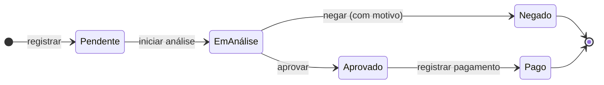
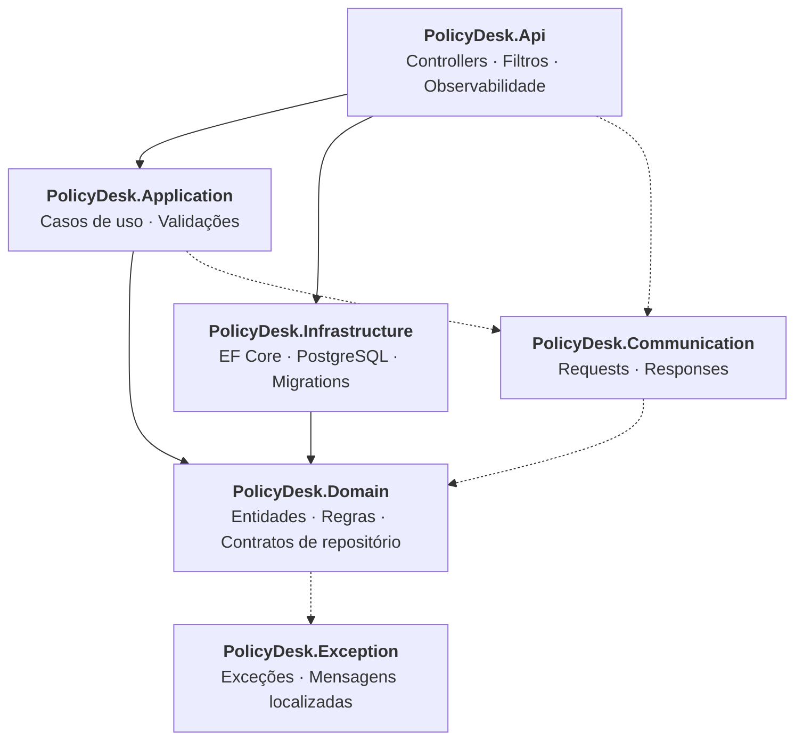
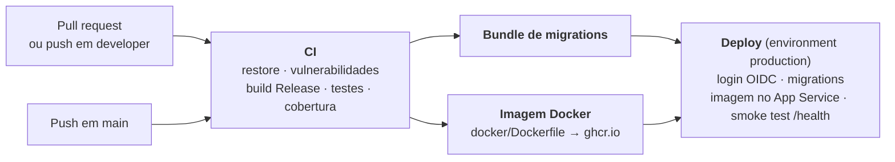

<div align="center">

# 🛡️ PolicyDesk

**API REST para gestão de seguros: segurados, apólices e o ciclo de vida completo de sinistros.**

[](https://dotnet.microsoft.com/)
[](https://learn.microsoft.com/dotnet/csharp/)
[](https://www.postgresql.org/)
[](https://docs.docker.com/compose/)
[](https://opentelemetry.io/)
[](https://github.com/Rodrigosdk/PolicyDesk/actions/workflows/ci.yml)
[](https://github.com/Rodrigosdk/PolicyDesk/actions/workflows/cd.yml)
[](LICENSE)

[Sobre](#-sobre) •
[Funcionalidades](#-funcionalidades) •
[Arquitetura](#-arquitetura) •
[Tecnologias](#-tecnologias) •
[Como executar](#-como-executar) •
[Endpoints](#-endpoints) •
[Testes](#-testes) •
[CI/CD](#-cicd) •
[Licença](#-licença)

</div>

---

## 📖 Sobre

O **PolicyDesk** é uma API backend que modela o núcleo operacional de uma seguradora: o cadastro de **segurados**, a emissão e o cancelamento de **apólices** e o fluxo de **sinistros**, da abertura ao pagamento.

O projeto foi construído como peça de portfólio, com foco em **qualidade de engenharia**: regras de negócio protegidas no domínio, separação clara de responsabilidades, tratamento de erros padronizado, controle de concorrência, observabilidade de ponta a ponta e uma suíte de testes que cobre do domínio ao banco de dados real.

---

## ✨ Funcionalidades

### 👤 Segurados
- Cadastro com validação de **CPF**, e-mail, telefone e data de nascimento
- Unicidade de CPF e e-mail entre segurados ativos
- Atualização de dados cadastrais
- Inativação (soft delete), bloqueada enquanto houver apólice vigente ou futura

### 📄 Apólices
- Emissão vinculada a um segurado ativo, com valor de cobertura, prêmio e período de vigência
- Listagem com filtros por segurado e status
- Cancelamento com registro da data

### 🚨 Sinistros
- Abertura validada contra a apólice: ela precisa estar ativa, a data da ocorrência precisa estar dentro da vigência e o valor não pode exceder a cobertura
- Fluxo de status controlado por uma máquina de estados no domínio:



Qualquer transição fora desse fluxo é recusada com uma mensagem de regra de negócio.

---

## 🏛️ Arquitetura

A solução segue os princípios da **Clean Architecture**: o domínio fica no centro, sem depender de frameworks, e as camadas externas dependem das internas.



```
PolicyDesk
├── src
│   ├── Backend
│   │   ├── PolicyDesk.Api              # Camada HTTP: controllers, filtros, ProblemDetails, OpenTelemetry
│   │   ├── PolicyDesk.Application      # Um caso de uso por operação (Register, Listing, Approve...)
│   │   ├── PolicyDesk.Domain           # Entidades ricas, enums, validadores e interfaces de repositório
│   │   └── PolicyDesk.Infrastructure   # DbContext, mapeamentos, repositórios, Unit of Work, migrations
│   └── Shared
│       ├── PolicyDesk.Communication    # Contratos de entrada e saída da API
│       └── PolicyDesk.Exception        # Hierarquia de exceções e mensagens (.resx)
└── tests
    └── src
        ├── CommonTestUtilities             # Builders de entidades, requests e mocks
        ├── PolicyDesk.Domain.Tests
        ├── PolicyDesk.Application.Tests
        ├── PolicyDesk.Infrastructure.Tests
        └── PolicyDesk.Api.IntegrationTests
```

### Decisões de design

| Tema | Abordagem |
| --- | --- |
| **Domínio rico** | Entidades com setters privados validam as próprias invariantes no construtor e nos métodos de transição de estado. |
| **Casos de uso** | Cada operação é uma classe com interface própria, o que mantém responsabilidades pequenas e testáveis isoladamente. |
| **Repositórios segregados** | Interfaces separadas para leitura (`ReadOnly`, sem rastreamento), escrita (`WriteOnly`) e alteração (`UpdateOnly`). |
| **Unit of Work** | A persistência é confirmada em um único ponto, ao final de cada caso de uso. |
| **Concorrência otimista** | Uso da coluna de sistema `xmin` do PostgreSQL como token de concorrência; conflitos retornam `409 Conflict`. |
| **Erros padronizados** | Todas as respostas de erro seguem o **ProblemDetails (RFC 9457)**, com a lista `errors` e o `traceId` da requisição. |
| **Mensagens centralizadas** | Textos de erro em arquivo de recursos (`.resx`), com localização por `Accept-Language` já configurada no pipeline. |
| **Cancelamento** | O `CancellationToken` é propagado dos controllers até o banco; requisições abortadas pelo cliente retornam `499`. |
| **Higiene do código** | Analisadores do .NET ativos no build, `TreatWarningsAsErrors` e versões de pacotes centralizadas (`Directory.Packages.props`). |

---

## 🧰 Tecnologias

| Categoria | Ferramentas |
| --- | --- |
| **Plataforma** | .NET 10, ASP.NET Core, C# |
| **Persistência** | Entity Framework Core 10, PostgreSQL 17 (Npgsql) |
| **Documentação da API** | OpenAPI nativo + Swagger UI |
| **Observabilidade** | OpenTelemetry (logs, traces e métricas), exportação OTLP, .NET Aspire Dashboard, health checks |
| **Testes** | xUnit, Shouldly, Moq, Bogus, Testcontainers, `WebApplicationFactory`, Coverlet |
| **Infraestrutura** | Docker (build multi-stage, usuário não-root), Docker Compose |

---

## 🚀 Como executar

### Pré-requisitos

- [Docker](https://www.docker.com/) e Docker Compose
- [.NET SDK 10](https://dotnet.microsoft.com/download) (apenas para executar fora do Docker ou rodar os testes)

### Opção 1 — Docker Compose (recomendado)

Sobe a API e o PostgreSQL com um único comando:

```bash
git clone https://github.com/Rodrigosdk/PolicyDesk.git
cd PolicyDesk
docker compose -f docker/compose.yml up --build
```

| Serviço | Endereço |
| --- | --- |
| API | http://localhost:8080 |
| Swagger UI | http://localhost:8080/swagger |
| Health check | http://localhost:8080/health |

As migrations são aplicadas automaticamente na inicialização, fora do ambiente de produção.

> A senha do banco pode ser definida pela variável `POSTGRES_PASSWORD`. Sem ela, é usado um valor padrão para desenvolvimento local.

#### Ferramentas de desenvolvimento (Aspire Dashboard e pgAdmin)

O `docker/compose.dev.yml` complementa o `docker/compose.yml` com as ferramentas de desenvolvimento: o Aspire Dashboard, para onde a API passa a exportar logs, traces e métricas, e o pgAdmin, já apontando para o banco do projeto. Elas só sobem quando os dois arquivos são informados:

```bash
docker compose -f docker/compose.yml -f docker/compose.dev.yml up -d --build
```

| Serviço | Endereço |
| --- | --- |
| Aspire Dashboard (logs, traces e métricas) | http://localhost:18888 |
| pgAdmin | http://localhost:5050 |

O servidor **PolicyDesk (local)** já aparece cadastrado; na primeira conexão, informe a senha do banco (`policy-desk-local`, ou o valor de `POSTGRES_PASSWORD`). Para derrubar tudo, use os mesmos `-f` com `down`.

### Opção 2 — Execução local com `dotnet run`

```bash
# 1. Suba o banco e as ferramentas de desenvolvimento
docker compose -f docker/compose.yml -f docker/compose.dev.yml up -d db dashboard pgadmin

# 2. Configure a connection string via User Secrets
dotnet user-secrets set "ConnectionStrings:DbConnection" \
  "Host=localhost;Port=5432;Database=PolicyDesk;Username=admin;Password=policy-desk-local" \
  --project src/Backend/PolicyDesk.Api

# 3. Execute a API
dotnet run --project src/Backend/PolicyDesk.Api
```

A API ficará disponível em http://localhost:5045, com o Swagger em http://localhost:5045/swagger.

---

## 🔌 Endpoints

### Segurados — `/api/segurados`

| Método | Rota | Descrição |
| :---: | --- | --- |
| `GET` | `/api/segurados?pagina=&tamanhoPagina=` | Lista os segurados ativos, paginado |
| `GET` | `/api/segurados/{id}` | Busca um segurado |
| `POST` | `/api/segurados` | Cadastra (ou reativa) um segurado |
| `PUT` | `/api/segurados/{id}` | Atualiza os dados de um segurado |
| `DELETE` | `/api/segurados/{id}` | Inativa um segurado |

### Apólices — `/api/apolices`

| Método | Rota | Descrição |
| :---: | --- | --- |
| `GET` | `/api/apolices?seguradoId=&status=&pagina=&tamanhoPagina=` | Lista apólices, com filtros opcionais e paginado |
| `GET` | `/api/apolices/{id}` | Busca uma apólice |
| `POST` | `/api/apolices` | Emite uma apólice |
| `POST` | `/api/apolices/{id}/cancelamento` | Cancela uma apólice |

### Sinistros

| Método | Rota | Descrição |
| :---: | --- | --- |
| `POST` | `/api/apolices/{id}/sinistros` | Registra um sinistro na apólice |
| `GET` | `/api/apolices/{id}/sinistros` | Lista os sinistros de uma apólice |
| `GET` | `/api/sinistros/{id}` | Busca um sinistro |
| `POST` | `/api/sinistros/{id}/analise` | Inicia a análise |
| `POST` | `/api/sinistros/{id}/aprovacao` | Aprova o sinistro |
| `POST` | `/api/sinistros/{id}/negacao` | Nega o sinistro, informando o motivo |
| `POST` | `/api/sinistros/{id}/pagamento` | Registra o pagamento |

### Exemplo de uso

```bash
curl -X POST http://localhost:8080/api/apolices \
  -H "Content-Type: application/json" \
  -d '{
        "seguradoId": "3fa85f64-5717-4562-b3fc-2c963f66afa6",
        "descricao": "Seguro residencial",
        "valorCobertura": 250000.00,
        "valorPremio": 1200.00,
        "inicioVigencia": "2026-01-01",
        "fimVigencia": "2026-12-31"
      }'
```

### Convenções do contrato

- Campos do JSON em português e em camelCase (`seguradoId`, `valorCobertura`, `dataOcorrencia`, `criadoEm`).
- Status serializados como texto: apólice `Ativa` ou `Cancelada`; sinistro `Pendente`, `EmAnalise`, `Aprovado`, `Negado` ou `Pago`. O filtro `status` da listagem de apólices aceita os mesmos nomes.
- Cadastros respondem `201 Created` com `{ "id": ... }` e o cabeçalho `Location` apontando para o recurso criado.
- Valores monetários aceitam no máximo 2 casas decimais e 16 dígitos inteiros.
- Listagens paginadas usam `pagina` (a partir de 1) e `tamanhoPagina` (padrão 20, máximo 100), ordenadas pela data de cadastro:

```json
{
  "itens": [ ... ],
  "pagina": 1,
  "tamanhoPagina": 20,
  "totalItens": 42,
  "totalPaginas": 3
}
```

### Formato de erro

Todas as falhas seguem o mesmo contrato, com status HTTP coerente (`400`, `404`, `409`, `500`):

```json
{
  "type": "https://tools.ietf.org/html/rfc9110#section-15.5.1",
  "title": "Bad Request",
  "status": 400,
  "instance": "/api/apolices/3fa85f64-5717-4562-b3fc-2c963f66afa6/sinistros",
  "errors": [
    "O valor do sinistro excede a cobertura da apólice."
  ],
  "traceId": "4bf92f3577b34da6a3ce929d0e0e4736"
}
```

O mesmo `traceId` volta no cabeçalho `X-Trace-Id` de toda resposta e aparece nos logs e traces, o que permite rastrear qualquer requisição de ponta a ponta.

---

## 📊 Observabilidade

- **Traces** distribuídos do ASP.NET Core, de chamadas HTTP de saída e de consultas ao PostgreSQL (Npgsql)
- **Métricas** de requisições, runtime do .NET, EF Core e Npgsql
- **Logs estruturados** (JSON em produção) com uma linha por requisição, sem corpo nem query string, para não expor dados pessoais (**LGPD**)
- **Health check** em `/health`, incluindo a verificação de conectividade com o banco

A exportação OTLP só é ativada quando `OTEL_EXPORTER_OTLP_ENDPOINT` está definida. Com o `compose.dev.yml`, os dados chegam automaticamente ao Aspire Dashboard; só com o `compose.yml`, a exportação fica desligada.

---

## 🧪 Testes

A suíte conta com **mais de 240 testes**, organizados em quatro níveis:

| Projeto | Escopo |
| --- | --- |
| `PolicyDesk.Domain.Tests` | Invariantes das entidades, transições de estado e validadores (CPF, e-mail, telefone) |
| `PolicyDesk.Application.Tests` | Casos de uso isolados com repositórios simulados (Moq) |
| `PolicyDesk.Infrastructure.Tests` | Repositórios e Unit of Work contra um **PostgreSQL real** via Testcontainers |
| `PolicyDesk.Api.IntegrationTests` | Requisições HTTP de ponta a ponta, contratos de erro, concorrência e health check |

```bash
# Requer Docker em execução para os testes com Testcontainers
dotnet test

# Com cobertura de código
dotnet test --collect:"XPlat Code Coverage"
```

---

## ⚙️ CI/CD

O pipeline roda no **GitHub Actions** e publica a API num **Azure App Service Linux no plano F1 (gratuito)**.



| Workflow | Quando roda | O que faz |
| --- | --- | --- |
| `ci.yml` | PRs para `main`/`developer`, push em `developer` | Build com analisadores como erro, auditoria de pacotes vulneráveis, todos os testes (com Testcontainers) e relatório de cobertura no resumo da execução |
| `cd.yml` | Push em `main` ou manual | Reaproveita o CI, gera o bundle de migrations e a imagem Docker (publicada no `ghcr.io`) e faz o deploy no environment `production` |
| `codeql.yml` | PRs, pushes e semanalmente | Análise estática de segurança do código C# |
| `dependabot.yml` | Semanalmente | PRs de atualização de NuGet, Actions e imagens Docker, agrupados |

**Decisões:**

- **Sem segredos de longa duração**: o login na Azure usa OIDC (federated credentials); a identidade só tem `Website Contributor` no próprio Web App.
- **Build once, deploy many**: a imagem testada é a mesma que vai para produção, gerada pelo mesmo `docker/Dockerfile` usado localmente e identificada pelo SHA do commit.
- **Migrations fora da inicialização**: um *migrations bundle* do EF Core é aplicado antes do deploy, então a API em produção nunca altera o schema ao subir.
- **Infraestrutura como código**: o banco, o plano F1 e o Web App estão descritos em [`infra/main.bicep`](infra/main.bicep).

### Primeiro deploy

Com o Azure CLI e o GitHub CLI autenticados (`az login` e `gh auth login`), um único comando provisiona o PostgreSQL Flexible Server, o plano F1 e o Web App, e configura no GitHub o environment `production`, os secrets e a variável:

```bash
./infra/bootstrap.sh
```

Depois, basta fazer merge em `main`. Detalhes, variáveis opcionais e problemas comuns na [wiki](https://github.com/Rodrigosdk/PolicyDesk/wiki/CI-CD-e-Deploy).

> **Limites do F1:** 60 minutos de CPU por dia, 1 GB de RAM, sem *Always On* (a primeira requisição após inatividade é lenta) e sem deployment slots. Em produção real, um plano B1 ou superior habilita slots para deploy sem downtime.

---

## 📝 Licença

Distribuído sob a licença **MIT**. Consulte o arquivo [LICENSE](LICENSE) para mais detalhes.

---

<div align="center">

Desenvolvido por **Rodrigo Mamede**

[](https://github.com/Rodrigosdk)

</div>
